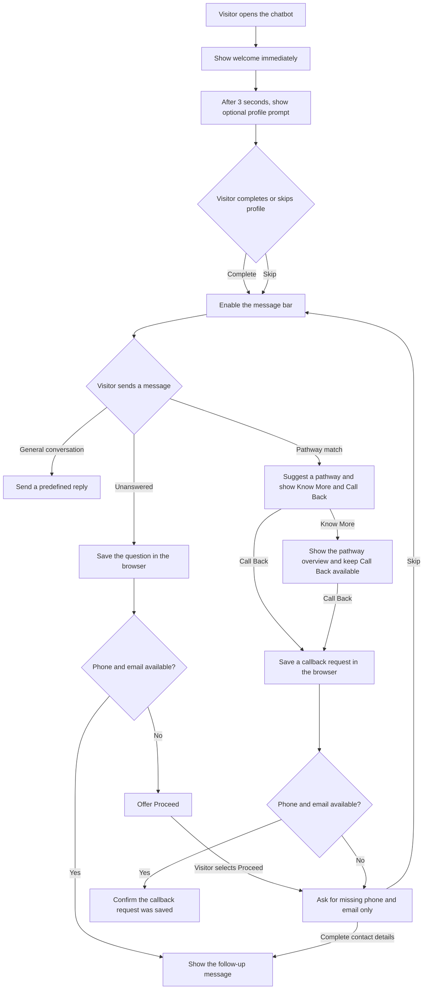

# Chatbot

The ZillionPathways support chatbot guides visitors through optional profile setup, answers common conversational messages, and suggests learning pathways. It also records unanswered questions and callback requests for follow-up in the visitor’s browser.

## Contents

- [Run locally](#run-locally)
- [Chatbot workflow](#chatbot-workflow)
- [Technology used](#technology-used)
- [Algorithms used](#algorithms-used)
- [User experience and interaction notes](#user-experience-and-interaction-notes)
- [Chat history and follow-up data](#chat-history-and-follow-up-data)

## Run locally

Serve `dist/` from the repository root with Python 3.

```bash
python3 -m http.server 3000 --bind 127.0.0.1 --directory dist
```

Open the chatbot in a browser. [Local chatbot](http://127.0.0.1:3000)

## Chatbot workflow



### Opening and profile

The first message is “Hi! Welcome to ZillionPathways. I’m here to help you get started.”

The next message appears after **3 seconds**. It reads, “You can share a few details so our team can follow up if needed, or select Skip to go straight to the chat.” The full-name prompt appears in the same bubble.

The initial profile asks for **full name → email → phone → role → pathway**. A visitor can complete the profile or select **Skip** at any prompt to open chat with the answers already entered.

| Profile choice | Options |
| --- | --- |
| Role | Parent, Student, Working professional, Organisation |
| Pathway | **Not sure yet, please advise**, Academic Excellence Pathway, Language Proficiency Pathway, Global Education Pathway, Communication & Leadership Pathway, Unwritten Skills |

### Chat responses and follow-up

General messages such as “Hi,” “Who are you?”, “Help,” and “Thank you” get short replies. “I want to improve my English” suggests the **Language Proficiency Pathway**. **Know More** displays an overview in the chat. **Call Back** records a request with the original question and pathway.

| Situation | Visitor sees |
| --- | --- |
| Unanswered question with phone and email available | “Someone from ZillionPathways will reach out to you for assistance.” |
| Unanswered question with missing contact details | “I’m not able to answer you right away. Select Proceed to submit your details so someone from ZillionPathways can reach out to you for further assistance.” The message includes a **Proceed** button. |
| **Call Back** with phone and email available | “Your callback request for the [pathway] has been saved in this browser.” |
| **Call Back** with missing contact details | An inline prompt for the missing contact details. |

When the visitor selects **Proceed** or an incomplete-contact **Call Back**, the chatbot asks for missing fields in **phone → email** order. If it already has an email address, it asks only for a phone number. Once both fields are available, it displays the follow-up message. The original question and earlier answers stay with the same conversation.

## Technology used

| Technology | Role |
| --- | --- |
| HTML and CSS | Static chat interface, inline forms, responsive layout, and animated typing indicator. |
| Vanilla JavaScript | Reply matching, form validation, interaction state, and timed replies. |
| Browser Web Storage | `localStorage` holds the saved conversation. `sessionStorage` identifies the active conversation in the current tab. |
| ChatGPT Sites | Hosts the demo as static files. Serve `dist/` as the web root when hosting this branch elsewhere. |
| Git and GitHub | Version and share the chatbot source. |

- Page markup and entry point. [dist/index.html](dist/index.html)
- Reply rules and chat logic. [dist/app.js](dist/app.js)
- Interface styles and animation. [dist/styles.css](dist/styles.css)

## Algorithms used

1. **Normalize input.** Lowercase the message, replace runs of characters outside `a–z` and `0–9` with spaces, and trim surrounding whitespace.
2. **Match replies in order.** Check for an exact normalized conversational phrase. Then look for a whole pathway name in the message, followed by configured keyword phrases. If several keywords match, use the first matching pathway in the configured order. Unmatched questions go to follow-up.
3. **Track the conversation state.** Switch between initial profile setup, chat, and contact collection. Each collection step selects the next unanswered field in that flow. A pending reply pauses sending until the bot responds.
4. **Validate profile inputs.** Require a nonblank name for that prompt, use browser email-format validation, and check that a phone number uses allowed characters and contains 7–15 digits after formatting is removed.
5. **Save and restore the conversation.** Write the transcript, answers, active prompt or action, and follow-up records as JSON under a browser-generated visitor ID. On refresh, use the current tab’s active ID to rebuild the chat and its controls.

## User experience and interaction notes

- The message bar stays disabled during profile and contact prompts and reads **Select Skip to chat**. In chat mode it reads **Type your question…**.
- Text fields appear between the bot’s question and **Skip**, with **Continue** to submit. Role and pathway options appear as buttons inside the conversation.
- A typing indicator appears during the opening delay and before later bot replies, which generally use a **550 ms** pause.
- Some replies use the visitor’s first name once it is available, including after a partial profile.
- The interface supports keyboard interaction, screen-reader labels and announcements, responsive layouts, and reduced-motion preferences.

## Chat history and follow-up data

The demo saves both sides of the conversation, profile details, unanswered questions, and callback requests in the visitor’s browser. Refreshing the **same tab** restores the transcript and the active prompt or buttons. **Clear chat** resets the transcript while keeping saved details and follow-up requests.

The follow-up messages are part of the demo. Delivering the saved requests to the ZillionPathways team requires a separate integration.
